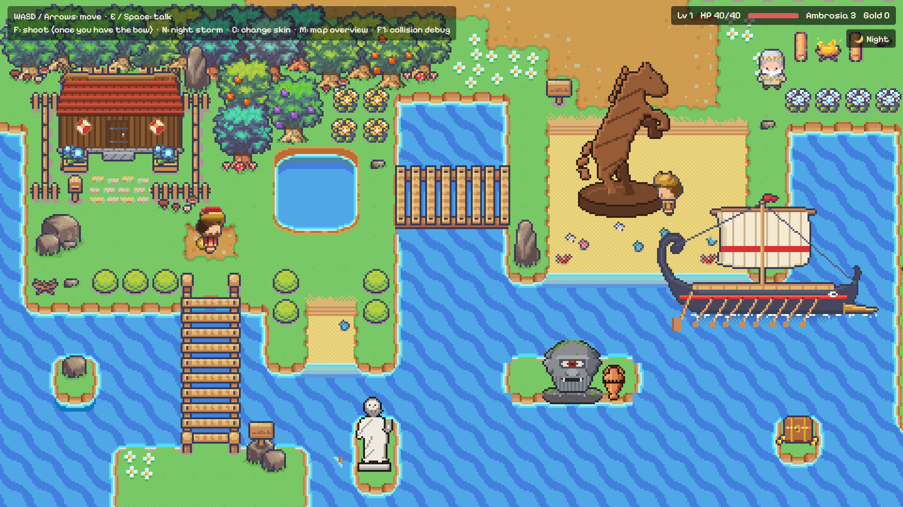

# ⚔️ ODYSSEY — An Interactive Mythological RPG
<p align="center">
  
</p>
**Explore ancient Greek mythology in a pixel-art adventure where every island hides a story, every encounter is a challenge, and the journey home is yours to discover.**

ODYSSEY (developed in the repository as **Island Warrior**) is a browser-based, top-down RPG built with **Phaser 3, TypeScript, and Vite**. Explore a handcrafted island, speak with characters, sail across the sea, discover dungeons, and fight mythological enemies in turn-based battles. The project also includes a separately developed **voice Oracle**, narrated-story tooling, and a backend prototype for recording and reviewing combat runs.

> **Project status:** Playable game with additional integrations at different stages of development. The Oracle runs as a separate voice service; it does **not** currently control or observe gameplay. The run-tracking API has a test harness, but its hooks are not yet wired into the live game.

## 🎮 Gameplay at a Glance

- **Explore an island:** Traverse a detailed top-down village, investigate landmarks, talk to NPCs, and discover entrances.
- **Travel by ship:** Board a vessel, navigate open water, and disembark near shorelines.
- **Discover mythological challenges:** Visit Circe's grotto and other dungeon environments, encounter monsters, and pursue rewards.
- **Fight tactical battles:** Choose to attack, defend, use Ambrosia to heal, or attempt to escape. Earn experience, level up, and strengthen your character.
- **Experience a living world:** Switch between day and stormy night, see weather effects, and explore with collision-aware movement.
- **Choose your appearance:** Cycle through character skins themed around Greek gods and heroes.
- **Play with keyboard or touch:** On-screen movement and action controls are available on touch devices.

## 🕹️ Controls

| Input | Action |
| --- | --- |
| `W A S D` / Arrow keys | Move; steer the ship |
| `E` / `Space` / `Enter` | Talk, interact, advance dialogue, board/disembark |
| `F` | Shoot after obtaining the bow |
| `N` | Toggle night storm |
| `C` | Change character skin |
| `M` | Toggle map overview |
| `F1` | Show collision/debug overlay |
| `1`–`4` | Select battle action |
| Arrow keys + `Enter` | Navigate and confirm battle actions |

**Tip:** Walk toward doors to enter accessible buildings and use ladders to return from dungeons. Some areas are locked until their content or unlock conditions are available.

## 🧰 Tech Stack

| Layer | Technology | Purpose |
| --- | --- | --- |
| Game engine | Phaser 3 | Scenes, sprites, input, Arcade Physics, battles |
| Frontend | TypeScript, HTML, CSS | Game logic and interface |
| Build tools | Vite | Local development and production builds |
| Maps and assets | Tiled JSON, Python tooling | Tilemap reconstruction, collisions, custom artwork |
| API | Node.js, TypeScript | Combat-run endpoints and integration harness |
| Data validation | Zod | API request validation |
| Database | PostgreSQL via `pg` / Tiger Data | Optional persistent runs and fight events |
| Voice experiment | Chert, LiveKit, OpenAI Realtime | Separate conversational Oracle agent |
| Narration pipeline | ElevenLabs | Offline narration asset generation |
| Deployment configuration | Docker Compose, Vultr | Prepared deployment setup; provisioning is separate |

## 🏗️ Architecture

```text
                       ODYSSEY
                          │
           ┌──────────────┴──────────────┐
           │                             │
     Browser Game                 Optional Services
     Phaser 3 + Vite                     │
           │                 ┌───────────┴────────────┐
    ┌──────┼───────┐         │                        │
    │      │       │      Node API              Voice Oracle
  Maps   Combat   UI     Run tracking          Chert/LiveKit
    │      │       │         │                  OpenAI Realtime
  NPCs  Enemies   HUD     Memory / PostgreSQL
  Ship  Rewards  Dialog
```

The game scenes live in `src/scenes/`, interactive entities in `src/entities/`, story and gameplay data in `src/data/` and `src/story/`, and map/asset generation scripts in `tools/`. Integration services are intentionally separate from the playable game.

## 🚀 Getting Started

### Requirements

- Node.js **24** and npm (recommended for the integration tooling)
- A modern desktop or mobile browser
- Python only if rebuilding maps or generated assets

### Run the game locally

```bash
git clone <YOUR_REPOSITORY_URL>
cd Odyssey-feat-chert-tiger-vultr
npm ci
npm run dev
```

Open the **Local** URL printed by Vite (normally `http://localhost:5173/`). If that port is already occupied, Vite automatically chooses another available port, such as `5174` or `5175`.

### Production build

```bash
npm run build
npm run preview
```

The build output is placed in `dist/`.

## 🗺️ Worlds and Gameplay Systems

### Island exploration

The main `village` map includes buildings, signs, NPCs, coastlines, bridges, a ship, and interactive landmarks. The map uses layered terrain and objects, depth sorting, and collision geometry.

### Dungeons and encounters

The repository defines scenes for `village`, `cave`, `dungeon`, `circe`, `cyclops`, and `telepylus`. Each area can have its own enemies, hazards, NPCs, and progression conditions. Not every entrance or storyline is necessarily unlocked in the current build.

### RPG combat

Battles run in a separate `BattleScene` over the paused world. Players can attack, defend, consume healing items, or flee when allowed. Combat includes enemy stats, critical hits, experience, leveling, and boss restrictions. Defeated enemies and opened chests are tracked in game state.

### Story and narration

Story data, playback logic, and narration assets are organized separately from scene rendering, making it easier to extend dialogue and narrative sequences. See [`docs/STORY.md`](docs/STORY.md) and [`docs/NARRATION.md`](docs/NARRATION.md).

## 🤖 Oracle Voice Agent — Experimental Integration

A separate Oracle agent is implemented under `agents/oracle/`. It uses Chert's voice workflow, LiveKit, and OpenAI Realtime to answer questions about game controls and the planned Odyssey journey.

**Important:** The Oracle is currently a standalone voice guide. It does not receive live game state, control the player, or verify in-game actions. Running it requires separate credentials and may incur provider charges.

Setup, credentials, commands, and limitations are documented in [`docs/INTEGRATIONS.md`](docs/INTEGRATIONS.md) and [`agents/oracle/README.md`](agents/oracle/README.md). Never commit `.env.local` or API keys.

## 📊 Combat Telemetry — Integration Prototype

The Node API can create runs, accept batches of fight events, complete runs, and return recaps. It supports temporary in-memory storage for local testing or PostgreSQL persistence when `DATABASE_URL` is configured. The included test harness records **test events**, not verified live gameplay events.

To try the API locally, in a separate terminal:

```bash
cp .env.example .env.local   # On Windows PowerShell: Copy-Item .env.example .env.local
npm run api:dev
```

Then open `http://localhost:3001/integrations` for the test harness. Without a database connection, run data is lost when the server restarts. See [`docs/INTEGRATIONS.md`](docs/INTEGRATIONS.md) for database migration, API contracts, security notes, and deployment instructions.

## 📁 Project Structure

```text
.
├── src/
│   ├── scenes/          # Preload, map, and battle scenes
│   ├── entities/        # Player, enemies, ship, weather, NPCs, archery
│   ├── data/            # Dialogue, enemies, voyage, narration
│   ├── story/           # Story state and playback
│   ├── narration/       # Narration interface
│   ├── main.ts          # Phaser configuration and scene registration
│   └── ui.ts            # HUD, dialogue, battle controls, touch inputs
├── public/              # Runtime game assets and maps
├── tools/               # Map generation, sprites, smoke tests
├── server/              # API, storage, schema, tests
├── integrations/        # Integration client and harness
├── agents/oracle/       # Standalone voice agent
├── docs/                # Story, narration, integration documentation
├── deploy/              # Deployment configuration
├── reference/           # Reference map artwork
├── index.html
└── package.json
```

## 🧪 Useful Commands

| Command | Description |
| --- | --- |
| `npm run dev` | Start the Vite development server |
| `npm run build` | Type-check and build the game |
| `npm run map:build` | Rebuild map JSON and associated generated artwork |
| `npm run map:cave` | Rebuild the cave map |
| `npm run map:dungeon` | Rebuild the sewer dungeon |
| `npm run map:circe` | Rebuild Circe's grotto map |
| `npm run characters` | Regenerate character sprites and skins |
| `npm run api:check` | Type-check the integration API |
| `npm run test:integrations` | Run API integration tests |
| `npm run smoke:story` | Run story smoke tests |
| `npm run smoke:challenges` | Run challenge smoke tests |
| `npm run smoke:weather` | Run weather smoke tests |

**Asset note:** The game uses committed runtime assets in `public/assets/`. Rebuilding certain source maps and sprite sheets requires separately obtaining the original third-party art packs. See the existing asset notes and license terms before redistributing or commercializing the game.

## 💡 Technical Highlights

- Layered tilemap rendering with depth-aware object sorting and physics collisions
- Reconstructed reference map using Python scripts and generated Tiled JSON
- Reusable map scenes and entity classes for expanding the world
- Turn-based combat with persistent encounter state during play
- Ship movement and shore interaction logic
- Independent voice, narration, and combat-event integration modules
- Automated test and smoke-test scripts for core systems

## 🔮 What's Next

Potential future improvements include deeper quest progression, additional boss encounters, connecting verified gameplay events to combat recaps, context-aware Oracle interactions, expanded sailing destinations, and more story-driven challenges. These are **roadmap ideas**, not claims of completed functionality.

## 📜 Credits and Asset Licensing

Built using Phaser and third-party pixel-art packs, including Serene Village, Fungus Cave, Fantasy Battlers, and LimeZu Modern Interiors artwork. The repository's existing documentation identifies additional attribution and asset-generation details.

**Licensing caution:** The free Modern Interiors assets are documented as **non-commercial use only**. Check the terms of every art pack before distribution or commercial use. No blanket open-source license for the entire project is asserted here.

---

**⚔️ Explore the island. Face the legends. Write your Odyssey.**
